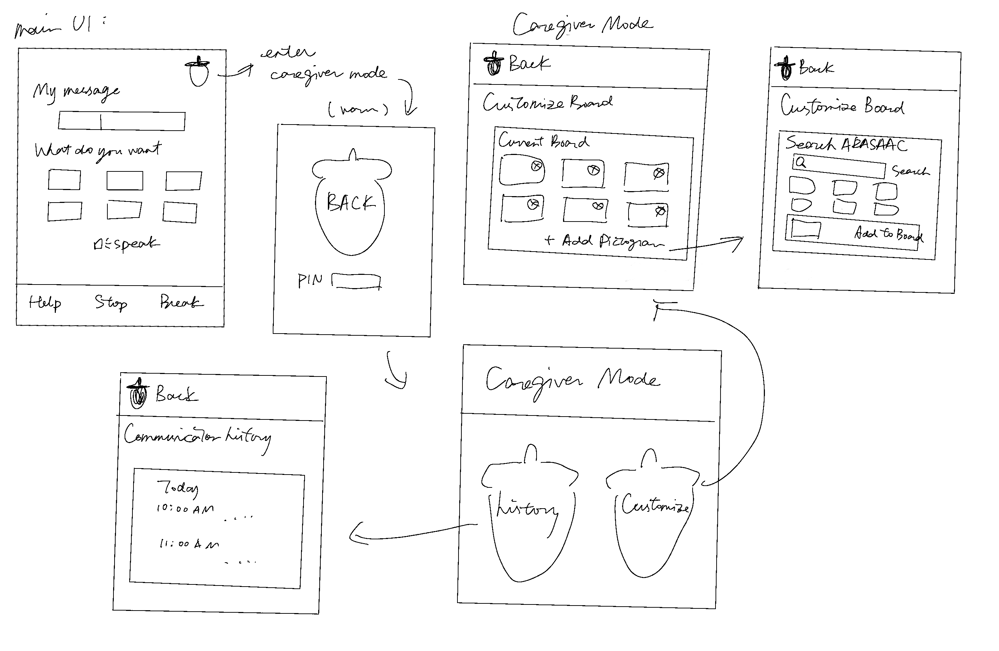

# AACorn - Visual AAC Communication Board

## Team Information

### Team Members

- Harleen Sidhu
- Ruoshui Deng
- Ruohan Tang
- Paul Zhao

---

## Project Description

### Domain

**Augmentative and Alternative Communication (AAC)**

AACorn is a Java-based visual AAC application designed primarily for autistic children around ages 5–12 with limited functional speech.

The goal is to help a child communicate simple everyday needs using pictograms.

**Example:**  
`I want` → `Water` → **"I want water."**

The first version focuses on functional communication rather than emotion detection, pain assessment, behaviour prediction, or other therapy-related features.

### Project Mascot

<p align="center">
  
</p>

AACorn's mascot is an original acorn-inspired character. It is used for project branding rather than as a functional AAC pictogram.

---

## User Stories

### Child

1. **As a child, I want to select pictograms so that I can communicate something I want.**

2. **As a child, I want quick access to Help, Stop, and Break so that I can communicate important needs easily.**

### Caregiver

3. **As a caregiver, I want to search for, add, and remove pictograms so that I can customize the child's communication board.**

4. **As a caregiver, I want to view previous messages so that I can see what the child has communicated.**

---

## Use Cases

### UC1 - Communicate a Request

**Actor:** Child

**Precondition:** The communication board contains at least one available pictogram.

**Trigger:** The child wants to communicate a request.

**Success Outcome:** A completed message is created and can be stored in communication history.

**Main Scenario:**

1. The child selects pictograms from the communication board.
2. The selected pictograms appear in the current message.
3. The child may add, repeat, remove, or clear selections.
4. The system constructs a readable message from the selected pictograms.
5. The completed message is sent.

**Extensions:**

- The same pictogram may be selected more than once.
- The child may remove a selected pictogram.
- An incomplete or cleared draft is not stored as a completed message.

---

### UC2 - Communicate a Core Message

**Actor:** Child

**Trigger:** The child selects **Help**, **Stop**, or **Break**.

**Success Outcome:** The selected core message is immediately available for communication.

**Main Scenario:**

1. The child selects a core message.
2. The system creates the corresponding communication message.
3. The completed message can be stored in communication history.

---

### UC3 - Customize the Communication Board

**Actor:** Caregiver

**Precondition:** The caregiver has entered caregiver mode.

**Trigger:** The caregiver chooses **Customize Board**.

**Success Outcome:** The child's available pictograms are updated.

**Main Scenario:**

1. The caregiver views the current communication board.
2. The caregiver may remove an existing pictogram.
3. The caregiver may select **Add Pictogram**.
4. The caregiver searches ARASAAC by keyword.
5. Matching pictograms are displayed.
6. The caregiver selects a pictogram to add to the board.
7. The updated board is saved.

**Extension:**

- If the API is unavailable or no matching pictogram is found, the system displays an appropriate message.

---

### UC4 - View Communication History

**Actor:** Caregiver

**Precondition:** At least one completed communication message has been saved.

**Trigger:** The caregiver chooses **History**.

**Success Outcome:** Previous communication messages are displayed in chronological order.

**Main Scenario:**

1. The caregiver opens communication history.
2. The system loads saved messages.
3. The messages are displayed with their timestamps.

---

## Minimal Viable Product (MVP)

Each team member will take the lead on one MVP use case.

| Team Member | MVP Use Case |
|---|---|
| TBD | UC1 - Communicate a Request |
| TBD | UC2 - Communicate a Core Message |
| TBD | UC3 - Customize the Communication Board |
| TBD | UC4 - View Communication History |

> MVP use-case ownership will be finalized before Phase 2 implementation.

---

## Entities

### `Pictogram`

Represents one selectable AAC symbol.

**Instance Variables**

```java
int id
String label
String imageLocation
```

**Relevant Methods**

```java
getId()
getLabel()
getImageLocation()
```

---

### `CommunicationDraft`

Represents the temporary message currently being constructed by the child.

**Instance Variables**

```java
String sentenceStarter
List<Pictogram> selectedPictograms
```

**Relevant Methods**

```java
addPictogram(...)
removeLastPictogram()
removePictogramAt(...)
repeatPictogramAt(...)
clear()
previewText()
buildMessage(...)
```

---

### `CommunicationMessage`

Represents a completed message sent by the child.

**Instance Variables**

```java
List<Pictogram> selectedPictograms
String text
LocalDateTime timestamp
```

**Relevant Methods**

```java
getSelectedPictograms()
getText()
getTimestamp()
```

A completed `CommunicationMessage` is immutable and is kept separate from the child's current `CommunicationDraft`.

---

### Planned: `CommunicationBoard`

Represents the vocabulary currently available to the child.

**Planned Responsibilities**

- store available pictograms
- add pictograms
- remove pictograms

---

### Planned: `ChildProfile`

Represents the saved state for the current child.

**Planned Data**

- customized `CommunicationBoard`
- communication history

---

## API Usage

**API Name:** ARASAAC API

**Documentation:** [ARASAAC API documentation](ADD_OFFICIAL_API_LINK_HERE)

**How it is used in the program:**

- search for pictograms by keyword
- retrieve pictogram metadata
- retrieve pictogram images
- allow caregivers to add selected pictograms to the communication board

**Current Status:** API research and Java integration are in progress. API functionality has not yet been merged into `main`.

---

## Persistence

AACorn plans to use local JSON storage for:

- the customized communication board
- pictogram information
- communication history

Development and testing use sample data rather than real clinical data.

---

## Design Diagrams

### UI Flow

AACorn has a child-facing communication interface and a separate caregiver mode.

<p align="center">
  
</p>

Caregiver mode is accessed from the child interface through a settings button and a 4-digit PIN screen.

The caregiver can then choose between:

- **History**
- **Customize Board**

### UML Class Diagram

**Status:** In progress.

The initial UML diagram will include the core entities and their relationships as the remaining domain model is finalized.

### Sequence Diagrams

**Status:** To be added during use-case implementation.

---

## Current Development Status

AACorn is currently in **Phase 1: Framework**.

| Area | Owner | Status |
|---|---|---|
| UI design and navigation | Team | Initial design completed |
| Communication logic | Ruoshui | Implemented and tested |
| Data model / architecture | Ruohan | In progress |
| ARASAAC API research | Paul | In progress |
| Swing prototype | Harleen | In progress |

### Implemented

- `Pictogram`
- `CommunicationDraft`
- `CommunicationMessage`
- add/remove/repeat pictogram logic
- message preview and construction
- communication edge-case tests
- JUnit configuration

### In Progress

- ARASAAC integration
- Swing GUI
- UML and Clean Architecture design
- `CommunicationBoard`
- `ChildProfile`
- JSON persistence
- communication history

---

## How to Run

The complete Swing application is not yet integrated.

The currently implemented domain logic and tests can be run with:

```bash
mvn clean test
```

A runnable GUI entry point will be added as the Swing prototype and use cases are integrated.

---

## Notes

### Current Technology

- **Language:** Java 11
- **GUI:** Java Swing
- **Build Tool:** Maven
- **Testing:** JUnit 5
- **External API:** ARASAAC
- **Persistence:** planned local JSON storage
- **Architecture:** Clean Architecture / SOLID principles

### Possible Future Extensions

The following are **not part of the current MVP**:

- text-to-speech
- communication usage statistics
- caregiver-facing vocabulary suggestions
- multiple child profiles
- richer child profile management
- previewing board changes before saving

Development is completed through feature branches and Pull Requests, with completed work reviewed before being merged into `main`.